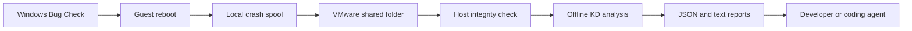

# Architecture

The guest runs a PowerShell exporter. The host runs a Python monitor and KD. They exchange files through VMware Shared Folders. Collection and analysis happen after reboot; there is no live kernel debugging connection.

## Guest

`Install-Guest.ps1` saves the current CrashControl values, their registry types, and the pagefile settings. It then enables Automatic Memory Dump, automatic reboot, and a system-managed pagefile. The SYSTEM startup task `Klay-Export` runs scripts from `C:\ProgramData\Klay`, which is writable by SYSTEM and administrators. Installation replaces existing access grants on the local tree, verifies its owner and ACLs, and refuses reparse points. The shared folder carries reports; the task runs a protected local copy of its code.

`-InstallRoot` must name one local directory directly below the system's real ProgramData folder. Relative/UNC paths, the ProgramData root, deeper children, reserved names and path aliases are rejected before directory creation or task changes. The default is `C:\ProgramData\Klay`; a direct sibling such as `C:\ProgramData\Klay-VM2` is allowed.

`Export-Crashes.ps1` polls every 15 seconds for a crash report associated with the current boot. It checks WER SystemErrorReporting event 1001 first, then Kernel-Power event 41 with a nonzero BugcheckCode. With boot evidence available, candidate events must follow `currentBootEventRecordId` and be dated no earlier than five seconds before Kernel-General `currentBootTimeUtc`. This avoids confusing an older report with a new crash during adjacent boots, including when Kernel-General precedes CIM. The crash ID still combines the computer name and CIM UTC boot timestamp. Older events aren't imported as a crash history.

When WER arrives after a fallback report, a ready capture is rebound only after its saved dump header passes code, four-parameter and boot-window checks against the candidate. Rejection preserves the ready report, source and `event.xml`; `reportUpgrade` records `state: rejected`, time, error and candidate fields, while `wer-upgrade-event.xml` preserves the candidate XML. Acceptance records `state: accepted` with previous/current event provenance, keeps the original XML in `event-fallback.xml`, and updates `dumpEvidence` event provider/record. A switch before capture is ready records `pending_dump_validation` and still must pass the dump guard before readiness. Both optional sidecars are published to the host. A legacy ready report without captured header evidence cannot be safely rebound.

The exporter writes metadata and copies the dump into a local spool before trying the share. It accepts Windows AMD64 kernel dump headers (`PAGEDU64`), compares the header's Bug Check code and all four parameters to the Windows event, and checks the header's system time against the previous/current boot interval with five seconds of tolerance. Both boundaries use Kernel-General event 12 `StartTime`, ordered by event record ID. The latest event must agree with the current CIM boot time within 120 seconds; otherwise the boundary is ambiguous. `previousBoot` records the prior time and event, plus `currentBootTimeUtc` and `currentBootEventRecordId`. A missing boundary, mismatched header, or unsupported dump remains `waiting_for_dump` with an error; a filesystem timestamp alone doesn't establish identity.

It waits if a writer still holds the dump. Once the copy is stable, it verifies the copied header and records size, SHA-256 and capture time. A local ledger retains the last 128 dump/hash associations and refuses the same hash for another crash. Pending captures from the most recent 64 spool directories can resume after a further reboot, using their original boot boundaries. `dumpEvidence` records the header, event provenance, copy time and original path; `captureRecovery` records a later boot used to resume capture.

On the share, the dump first has a `.partial` filename. The exporter verifies the transferred copy, renames it to `memory.dmp`, and writes `ready.json` last. It then deletes the duplicate spool dump. The Windows dump and host archive stay in place. If publication fails, the local spool is available for the next attempt.

The guest also writes a heartbeat with dump settings, active pagefiles, and recent system events. Events include their provider because an event ID alone doesn't identify the report type. Its top-level `selectionProtocol: immutable_v1` reports the exporter's capability; `observedBuild` acknowledges a selected manifest after the guest reads it. The observation's own `selectionProtocol` and `selectionRecord` identify the effective source. `buildObservationError` reports a rejected or unavailable observation.

For `immutable_v1`, the exporter lazily enumerates top-level JSON files in `build-selections`, retaining only the largest valid chronological filename. It stops with an error if there are more than 1,024 JSON entries; it never silently selects from a partial history. The selected file must be at most 64 KiB. Its schema, protocol, record name, build ID and exact UTC arm time must agree with `YYYYmmddTHHMMSSffffffZ_<buildId>.json`. Hashing and parsing use one handle for consistent bytes; the handle allows read/delete sharing but denies in-place writers. A corrupt selected record isn't replaced by an older record or the legacy pointer. Legacy `active-run.json` is read only when the directory is absent or has no JSON files; JSON entries with no valid filename are an error.

`environment` records OS build/UBR, release, edition and architecture, Secure Boot, DeviceGuard configured/running services, and Defender antivirus/realtime/tamper state. The exporter refreshes this read-only context on the next poll after 60 seconds. DeviceGuard and Defender CIM queries have five-second operation timeouts; their service lists are limited to 16 entries and individual errors to 1,024 characters. Missing or failed observations remain null with an error where available, rather than being reported as disabled.

The local `healthy-observations.json` journal retains the last observation of up to 64 boots. `preCrashObservation` selects an observation whose timestamp precedes the validated dump time and whose `kernelBootTimeUtc` matches the crashed boot's Kernel-General boundary within five seconds. It preserves that observation's environment, build acknowledgment, pagefiles and dump settings. `postBootEnvironment` records the first environment context observed after the recovery boot. Each environment has its own `observedAtUtc` and provenance; neither proves the exact security state at the instant of failure. A missing pre-crash observation remains unknown.

A local journal retains the last 64 build observations. After validating the dump time, the exporter selects the latest observation whose arming and first-observation times precede that crash. `buildCorrelation.state` is `observed_before_crash` or `unknown`, and `armedBuild` remains null when no eligible observation exists. A manifest first seen after the crash can't be assigned to it. Observation records test intent, not driver installation or the identity of the loaded module.

`buildCorrelation` and `buildObservations` retain the selection protocol and record name alongside timing/hash evidence. These records identify which selection the guest observed, not an attestation of the loaded driver.

## Host

`klay watch` refreshes status every five seconds and sends pending dumps to one analysis worker. A file lock prevents a second monitor from using the same runtime directory. Give each shared root one monitor and its own runtime directory.

Before starting KD, the monitor checks that `ready.json` identifies the crash directory, names `memory.dmp`, and matches the file's size and SHA-256. KD reads a command file and uses Microsoft symbols cached under the runtime directory. If a build was selected, it also gets the archived driver and PDB paths. The arguments include `-noshell` to disable shell commands and `-sins` to ignore debugger environment settings.

The monitor marks an analysis `complete` when KD exits with code zero, prints the completion marker, and reports a Bug Check code that matches the event when supplied. It also compares the four parameters when KD provides them. `eventConsistency` distinguishes matched values from missing event data or parameters that KD didn't report. On failure, the dump and debugger output remain available. After a monitor restart, interrupted `running` analyses return to `pending` for another attempt. `once` processes the current pending work and returns a nonzero exit code if an analysis processed in that invocation fails.

`arm` copies the selected `.sys` and optional `.pdb` into the build archive and records their hashes. A missing PDB is recorded rather than silently replaced with another build's symbols. When available, the PE CodeView and PDB GUID/age are compared; a mismatch rejects arming. With `--source`, it records the source path and, for a Git repository, the revision and whether the worktree had changes. Source files stay at that path, so the caller must preserve the version used for the build, including uncommitted changes.

It stores `build.json` in that archive and atomically publishes the same manifest as a new `build-selections/YYYYmmddTHHMMSSffffffZ_<buildId>.json`, without overwriting an existing selection. The record uses schema 1 with `selectionProtocol: immutable_v1` and its exact `selectionRecord` filename. Immutable publication is required for success. Updating `active-run.json` is best effort for older guests: a transient `PermissionError` gets bounded retries, and a persistent lock returns success with `legacyPointerUpdated=false` and `compatibilityWarning` in the CLI result. Other publication failures propagate. Those result fields describe the compatibility write, not guest acknowledgment.

Ordinary host JSON replacement retries only transient `PermissionError`, up to five attempts with delays of 100/200/300/400 milliseconds. The same partial file is reused and cleaned up on final failure. This is a publication retry, not a retry of KD analysis or a relaxation of integrity checks.

The guest reports the selected build ID. The host finds that ID inside its configured build archive and checks the local file hashes before giving the paths to KD. Guest metadata cannot supply an arbitrary host build path. The selected build still needs to match the module and PDB that appear in the debugger report. Arming and file integrity are separate from proof of the module actually loaded in the guest.

`analysis.txt` retains KD's complete output. `analysis.json` extracts Bug Check arguments and descriptions, stack/register evidence, debugger fields, warnings, symbol quality and system context for consumers that need structured data. Quoted entries carry the original line numbers. Stack evidence is limited to 256 entries, registers to 64, warnings to 128, and module/system evidence to 32,768 characters each; the corresponding truncation fields direct consumers to the full text. `faultingInstruction` quotes KD's `FAULTING_IP` or `IP_IN_PAGED_CODE` block. Recognized warning entries may carry `kind: dump_memory` or `symbol_loading`, including the symbol-loading error table. `stackCommand` records KD output and is never executed automatically.

These fields retain evidence and limitations rather than assigning a root cause. `MODULE_NAME`, `IMAGE_NAME` and `FAILURE_BUCKET_ID` describe debugger attribution; they are not a verdict that the named module introduced the defect. A completed pipeline can still lack private symbols or pages needed for a diagnosis. The `latest.json` pointer includes `analysisJsonPath` as well as the text report path.

## Files and states

| Location | Purpose |
| --- | --- |
| Configuration | Absolute shared, runtime, build and optional KD paths; poll/time limits. |
| Guest installation | Protected scripts, original settings backup, local status and spool. |
| Shared root | Installation receipt, heartbeat, immutable build selections, legacy pointer and per-crash archives. |
| Runtime root | Host status, latest crash pointer, monitor lock/state, log and symbol cache. |
| Build root | Exact driver/PDB archives and build manifests. |

JSON uses `schema: 1`. Document a migration before changing what its fields mean. `latest.json` points to the newest observed boot. Its `analysisState` tells the reader whether the dump is missing, queued, being analyzed, or finished.

The richer reports extend schema 1 with optional evidence fields. Existing archives remain readable; absent correlation or symbol fields mean unknown, not a successful check. New build manifests allow null `pdb`/`pdbSha256` and record `noPrivateSymbols`, PE/PDB identities and `pdbMatch`; consumers must tolerate the missing PDB. Newly captured crashes assign `armedBuild` from a pre-crash guest observation rather than whichever host manifest exists after reboot. Old `armedBuild` values don't establish that timing. Reinstall the guest scripts to use the new capture checks; updating only the host doesn't retrofit evidence into an old report.

For selection-protocol migration, update the host and reinstall the guest exporter. Confirm a fresh heartbeat with `selectionProtocol=immutable_v1`, then arm a build and wait for matching `observedBuild.buildId`, `selectionProtocol` and `selectionRecord`. An older guest only sees `active-run.json`, which can remain stale when locked. Preserve old archives; the new protocol doesn't retrofit acknowledgment or timing evidence. There is no automatic selection cleanup. Manually archive older selection records outside the share before the 1,024-entry limit, keeping the current selection and records needed for active tests; don't edit a record to change its time or identity.

Copying a large dump can delay the guest heartbeat. A stale heartbeat therefore sets reachability to `unknown`. Bug Check detection uses the Windows event, and that event may reach the host before the dump finishes copying.

## Diagnostic limits

The installer changes dump, pagefile and task settings and preserves the previous values for restore. It does not change Secure Boot, HVCI, driver signature enforcement, Defender or UWF. OS, dump and security context fields are observations; they are not an attestation of all security controls. A driver's signature and compatibility with the guest's protections must be checked by the driver test. Compare the separately timestamped observations before a test and after recovery; post-reboot state doesn't prove the state at crash time.

Automatic Memory Dump contains kernel memory. Offline KD can only inspect data present in that dump and available binaries/symbols. It cannot continue execution, set a breakpoint before the failure, or reconstruct missing user buffers. Use a larger Windows dump when a test requires those pages. Live KD/KDNET requires a separate setup and security decision; the relay doesn't enable it.

Driver Verifier is also configured separately. The default KD commands collect its available statistics, but the presence of `!verifier` in a command file does not prove that the failing driver was verified. Record the driver names and enabled options as part of the test.

## References

- [Microsoft: Automatic Memory Dump](https://learn.microsoft.com/en-us/windows-hardware/drivers/debugger/automatic-memory-dump).
- [Microsoft: KD command-line options](https://learn.microsoft.com/en-us/windows-hardware/drivers/debugger/kd-command-line-options).
- [Microsoft: Symbol path](https://learn.microsoft.com/en-us/windows-hardware/drivers/debugger/symbol-path).
- [Microsoft: Unexpected reboot event logs](https://learn.microsoft.com/en-us/troubleshoot/windows-server/performance/troubleshoot-unexpected-reboots-system-event-logs).
- [Microsoft: Bug Check data and diagnosis](https://learn.microsoft.com/en-us/windows-hardware/drivers/debugger/blue-screen-data).
- [Microsoft: Driver Verifier](https://learn.microsoft.com/en-us/windows-hardware/drivers/devtest/driver-verifier).
