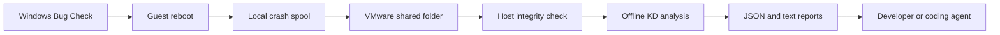

# Architecture

klay has a Windows PowerShell guest exporter and a Python host monitor. The shared folder carries data; the guest task executes a protected local copy of its scripts. No network server or AI provider integration is required.

## Guest

`Install-Guest.ps1` backs up CrashControl values with their registry types and raw data, together with pagefile settings. It enables Automatic Memory Dump and automatic reboot, configures a system-managed pagefile and registers the SYSTEM task `Klay-Export`. The default installation is `C:\ProgramData\Klay`.

`Export-Crashes.ps1` polls every 15 seconds. Crash identification is based on the current boot: WER SystemErrorReporting event 1001 takes precedence; Kernel-Power event 41 is a fallback only when its BugcheckCode is nonzero. The crash ID combines the computer name and the UTC boot timestamp. This version captures the crash preceding the current boot rather than reconstructing every historical event.

Capture writes metadata and copies the dump into a local spool before attempting publication. It checks the timestamp window, blocks capture while a writer holds the file and records a SHA-256 hash. Publication copies to a `.partial` filename, verifies the copy, renames the dump and writes `ready.json` last. Successful publication removes only the duplicate spool dump; the Windows dump and crash archives remain. Unpublished spools survive a temporary loss of share access.

The guest upgrades a fallback report when WER becomes available and emits a heartbeat containing dump settings, active pagefiles and provider-qualified system events.

## Host

`klay watch` refreshes status every five seconds and uses one analysis worker. A runtime file lock prevents concurrent monitors using the same runtime directory. Configure one monitor and runtime per shared root.

A ready manifest must identify the same crash directory, name `memory.dmp`, and match the dump's size and SHA-256. KD receives a fixed command file, Microsoft symbols, an isolated symbol cache and optional archived driver/PDB paths. Shell commands are disabled with `-noshell`; environment debugger settings are ignored with `-sins`.

A successful result requires KD exit code zero, a completion marker and a parsed Bug Check code. The code must agree with the event; available parsed parameters must also agree. Failure keeps the dump and debugger output. On monitor restart, an interrupted `running` analysis becomes pending and is retried.

`arm` archives exact `.sys` and `.pdb` bytes and records optional source/Git metadata. The guest's build reference is resolved through the configured host build archive and verified against local hashes. Arming identifies the planned test; module and symbol matching remain a debugger check. Source files are referenced rather than snapshotted.

## Files and states

| Location | Purpose |
| --- | --- |
| Configuration | Absolute shared, runtime, build and optional KD paths; poll/time limits. |
| Guest installation | Protected scripts, original settings backup, local status and spool. |
| Shared root | Installation receipt, heartbeat, active build and per-crash archives. |
| Runtime root | Host status, latest crash pointer, monitor lock/state, log and symbol cache. |
| Build root | Exact driver/PDB archives and build manifests. |

JSON uses `schema: 1`; changes to field semantics need a documented compatibility decision. `latest.json` selects the newest boot, not whichever analysis finished last. Readers use `analysisState` to distinguish missing dumps, queued/running analysis and complete/failed results.

Heartbeat freshness is a reachability signal. Dump transfer can delay guest heartbeat writes, and the host cannot infer a Bug Check from silence. Metadata, publication and analysis are separate stages, so an event may be available while the dump is still pending.

## Boundaries

All crash reports and dumps are local artifacts. Treat guest metadata, debugger output and custom command files as diagnostic data to review. The SYSTEM task must continue executing only protected local code. Deployment credentials are used only for an optional `vmrun` installation; no watcher needs them.

This version targets Windows x64 with VMware Workstation Shared Folders. Live debugging, automatic driver deployment, source snapshots, retention policies and transport for other hypervisors are outside its current behavior.

## References

- [Microsoft: Automatic Memory Dump](https://learn.microsoft.com/en-us/windows-hardware/drivers/debugger/automatic-memory-dump).
- [Microsoft: KD command-line options](https://learn.microsoft.com/en-us/windows-hardware/drivers/debugger/kd-command-line-options).
- [Microsoft: Symbol path](https://learn.microsoft.com/en-us/windows-hardware/drivers/debugger/symbol-path).
- [Microsoft: Unexpected reboot event logs](https://learn.microsoft.com/en-us/troubleshoot/windows-server/performance/troubleshoot-unexpected-reboots-system-event-logs).
