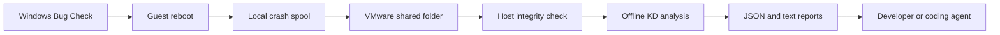

# Architecture

The guest runs a PowerShell exporter. The host runs a Python monitor and KD. They exchange files through VMware Shared Folders.

## Guest

`Install-Guest.ps1` saves the current CrashControl values, their registry types, and the pagefile settings. It then enables Automatic Memory Dump, automatic reboot, and a system-managed pagefile. The SYSTEM startup task `Klay-Export` runs scripts from `C:\ProgramData\Klay`, which is writable by SYSTEM and administrators. The shared folder carries reports; the task runs a protected local copy of its code.

`Export-Crashes.ps1` polls every 15 seconds for a crash report associated with the current boot. It checks WER SystemErrorReporting event 1001 first, then Kernel-Power event 41 with a nonzero BugcheckCode. If WER arrives later, it replaces the fallback report for that boot. The crash ID combines the computer name and the UTC boot timestamp. Older events aren't imported as a crash history.

The exporter writes metadata and copies the dump into a local spool before trying the share. It checks the dump's timestamp and waits if a writer still holds the file. Once the copy is stable, it records the size and SHA-256.

On the share, the dump first has a `.partial` filename. The exporter verifies the transferred copy, renames it to `memory.dmp`, and writes `ready.json` last. It then deletes the duplicate spool dump. The Windows dump and host archive stay in place. If publication fails, the local spool is available for the next attempt.

The guest also writes a heartbeat with dump settings, active pagefiles, and recent system events. Events include their provider because an event ID alone doesn't identify the report type.

## Host

`klay watch` refreshes status every five seconds and sends pending dumps to one analysis worker. A file lock prevents a second monitor from using the same runtime directory. Give each shared root one monitor and its own runtime directory.

Before starting KD, the monitor checks that `ready.json` identifies the crash directory, names `memory.dmp`, and matches the file's size and SHA-256. KD reads a command file and uses Microsoft symbols cached under the runtime directory. If a build was selected, it also gets the archived driver and PDB paths. The arguments include `-noshell` to disable shell commands and `-sins` to ignore debugger environment settings.

The monitor marks an analysis `complete` when KD exits with code zero, prints the completion marker, and reports a Bug Check code that matches the event. It also compares the four parameters when KD provides them. On failure, the dump and debugger output remain available. After a monitor restart, interrupted `running` analyses return to `pending` for another attempt.

`arm` copies the selected `.sys` and `.pdb` into the build archive and records their hashes. With `--source`, it records the source path and, for a Git repository, the revision and whether the worktree had changes. Source files stay at that path, so the caller must preserve the version used for the build.

The guest reports the selected build ID. The host finds that ID inside its configured build archive and checks the local file hashes before giving the paths to KD. Guest metadata cannot supply an arbitrary host build path. The selected build still needs to match the module and PDB that appear in the debugger report.

## Files and states

| Location | Purpose |
| --- | --- |
| Configuration | Absolute shared, runtime, build and optional KD paths; poll/time limits. |
| Guest installation | Protected scripts, original settings backup, local status and spool. |
| Shared root | Installation receipt, heartbeat, active build and per-crash archives. |
| Runtime root | Host status, latest crash pointer, monitor lock/state, log and symbol cache. |
| Build root | Exact driver/PDB archives and build manifests. |

JSON uses `schema: 1`. Document a migration before changing what its fields mean. `latest.json` points to the newest observed boot. Its `analysisState` tells the reader whether the dump is missing, queued, being analyzed, or finished.

Copying a large dump can delay the guest heartbeat. A stale heartbeat therefore sets reachability to `unknown`. Bug Check detection uses the Windows event, and that event may reach the host before the dump finishes copying.

## References

- [Microsoft: Automatic Memory Dump](https://learn.microsoft.com/en-us/windows-hardware/drivers/debugger/automatic-memory-dump).
- [Microsoft: KD command-line options](https://learn.microsoft.com/en-us/windows-hardware/drivers/debugger/kd-command-line-options).
- [Microsoft: Symbol path](https://learn.microsoft.com/en-us/windows-hardware/drivers/debugger/symbol-path).
- [Microsoft: Unexpected reboot event logs](https://learn.microsoft.com/en-us/troubleshoot/windows-server/performance/troubleshoot-unexpected-reboots-system-event-logs).
